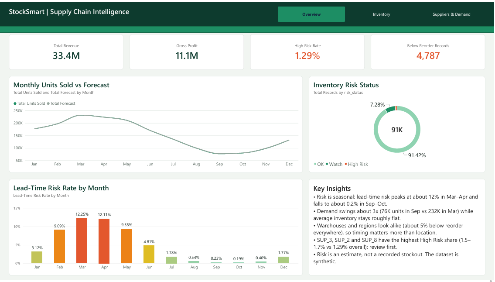
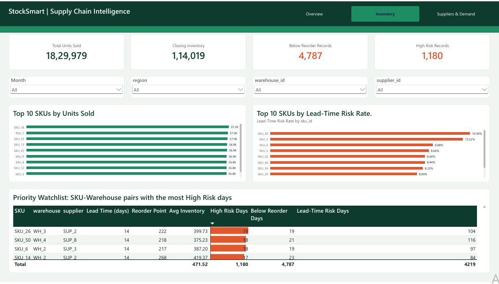
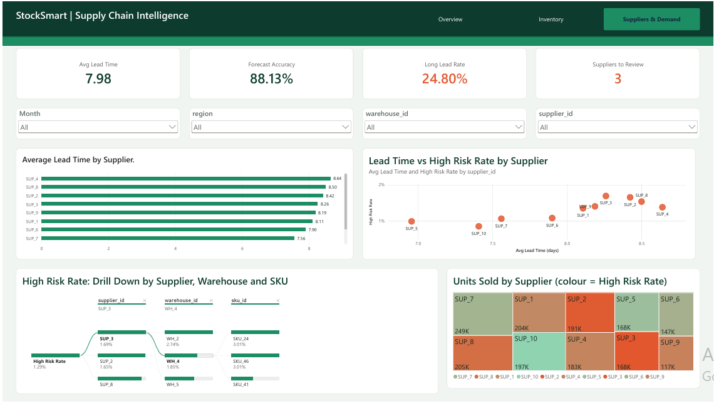

# StockSmart: Supply Chain Inventory Risk Analytics

A MySQL + Power BI project that shows when and where inventory is at risk of running short, which suppliers to review first, and how reliable the demand forecast is.

[Open the full dashboard as a PDF](powerbi/StockSmart_Dashboard.pdf)

## Business problem
An online retailer holds 50 products across 5 warehouses and 10 suppliers. Stock sometimes runs low, deliveries can take long, and managers do not know what to look at first. This project builds a reporting view that shows where inventory risk sits and what to investigate first.

## Dataset
- Source: "High-Dimensional Supply Chain Inventory Dataset" by ziya07 on Kaggle (link in data/README.md).
- Synthetic data, not from a real company. 91,250 rows, 15 columns, 50 SKUs, 5 warehouses, 10 suppliers, 4 regions, daily records from 2024-01-01 to 2024-12-30.
- Each row is one daily snapshot of one SKU in one warehouse (250 SKU-warehouse pairs x 365 days), so inventory is never summed across days.

## Tools
Excel for the web (first inspection), MySQL 8.0 and Workbench (15+ queries and a view), Power BI Desktop with DAX (3-page dashboard, 20 measures), GitHub.

## Data quality checks
| Check | Result |
|---|---|
| Rows / blank cells | 91,250 / 0 |
| Duplicate SKU-warehouse-date rows | 0 |
| Negative units sold or inventory | 0 |
| Unit price below unit cost | 0 |
| Rows with zero demand forecast | 892 (excluded from the lead-time risk test) |
| Recorded stockouts (Stockout_Flag = 1) | 0 in every row, so the flag is unusable |
| Supplier, lead time, reorder point and price | Fixed for each SKU-warehouse pair across the year |

Because the stockout flag is unusable, stockout risk is estimated instead of read from the data.

## Metric definitions
- Revenue = Units Sold x Unit Price. Gross profit = Units Sold x (Unit Price - Unit Cost).
- Below-reorder record: Inventory Level < Reorder Point.
- Lead-time risk record: Inventory Level < Demand Forecast x Supplier Lead Time (forecast above zero).
- High Risk = both conditions, Watch = one, OK = none.
- Forecast accuracy = 1 - WAPE, where WAPE = sum of absolute errors / sum of actual units.
- Long lead time = 12 days or more. Suppliers to review = High Risk rate more than 10% above the overall rate. Both thresholds are my own choices.

## Key findings
- Overall: 1,829,979 units, revenue 33.43M, gross profit 11.09M (33.17% margin). The dataset does not state a currency.
- Risk status: High Risk 1,180 records (1.29%), Watch 6,646 (7.28%), OK 83,424 (91.42%).
- Risk is seasonal. Lead-time risk is 12.25% in March and 12.11% in April, but 0.19% in October. Demand swings about 3x (231,596 units in March vs 76,304 in September) while average inventory stays between 454 and 527.
- Location matters little. Below-reorder rate is 5.18% to 5.30% across warehouses and 5.01% to 5.46% across regions.
- Suppliers: average lead time ranges from 6.96 days (SUP_5) to 8.64 days (SUP_4). SUP_3, SUP_2 and SUP_8 have the highest High Risk rates (1.69%, 1.65%, 1.54% vs 1.29% overall). SUP_8 has the largest share of long lead times (32.14%).
- Priority pairs: SKU_26 at WH_3 (supplier SUP_2, 14-day lead time) has the most High Risk days (19). 7 of the top 10 pairs have the maximum 14-day lead time.
- Forecast: accuracy at record level is 88.13% (WAPE 11.87%), while total forecast is within 0.14% of actual units, because errors cancel out in totals.
- Promotions: average units per record are 24.91 on promotion records vs 19.50 otherwise (about 28% more), at the same price. Below-reorder rate is 6.93% vs 5.06%, but promotions may fall in busy months, so this is an association only.

## Recommendations
1. Review reorder points and safety stock before February to May, and avoid over-stocking from August to November.
2. Review lead times or backup options for SUP_3, SUP_2 and SUP_8 first.
3. Work through the Priority Watchlist, starting with pairs that have a 14-day lead time.
4. Start recording real stockouts so risk can be measured instead of estimated.
5. Check stock levels ahead of planned promotions.

## Limitations
- Synthetic data and a single year, so findings show method, not real company performance.
- Risk is an estimate. It assumes demand follows the forecast during the lead time and ignores orders already in transit.
- Results show associations, not causes.

## Dashboard pages
**1. Overview:** revenue, gross profit, High Risk rate and below-reorder count; monthly units sold vs forecast; risk status split; lead-time risk by month; key insights.

**2. Inventory:** slicers for month, region, warehouse and supplier; top 10 SKUs by units sold and by lead-time risk rate; a Priority Watchlist of SKU-warehouse pairs with the most High Risk days.

**3. Suppliers and Demand:** average lead time by supplier; lead time vs High Risk rate scatter; a decomposition tree to drill from supplier to warehouse to SKU; a treemap of units sold by supplier coloured by risk.

## Repository structure
- data: source link and column dictionary
- sql: setup script and numbered analysis scripts, including the view inventory_enriched
- powerbi: StockSmart_Dashboard.pbix, StockSmart_Dashboard.pdf (full dashboard export) and StockSmart_Theme.json (colour theme)
- images: dashboard screenshots

## How to reproduce
1. Download the CSV from Kaggle and run sql/00_setup_and_load.sql in MySQL.
2. Run the numbered SQL scripts, including the one that creates the view inventory_enriched.
3. Open powerbi/StockSmart_Dashboard.pbix and point the MySQL connection (localhost:3307, database stocksmart) to your own server.

## Skills shown
SQL (aggregation, CASE, subqueries, window functions, views), data validation, DAX measures, dashboard design, business recommendations.
## Author
Nandana Gopan | [LinkedIn](https://www.linkedin.com/in/nandana-gopan-a6b136359/) | nandanagopan2504@gmail.com
